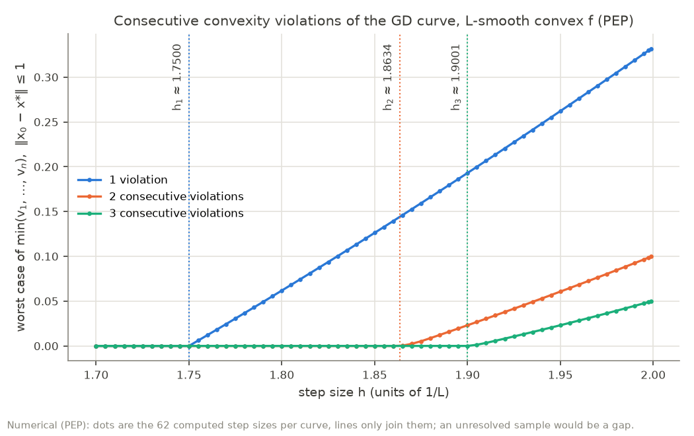
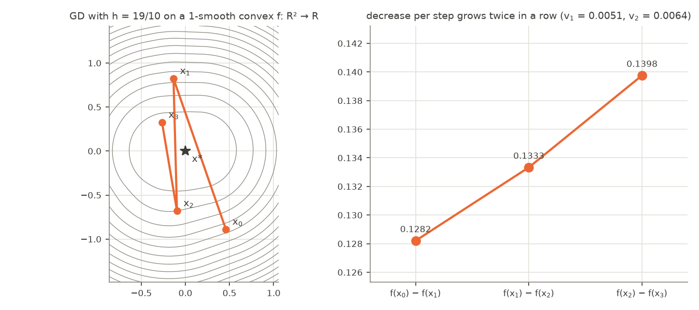
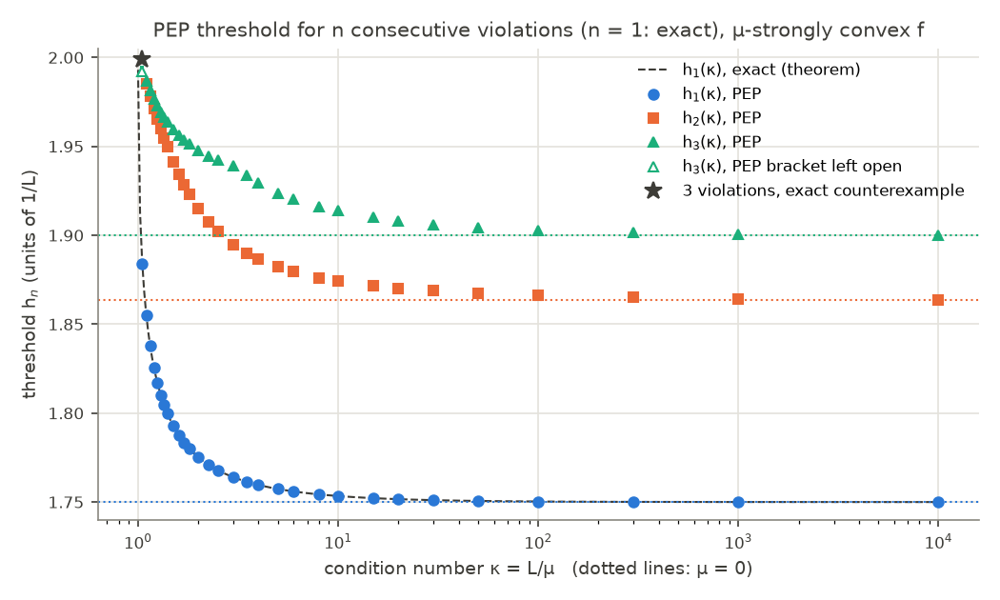

# optcurves: gradient descent optimization curves, convexity and consecutive violations

[](https://github.com/AbdulazizHGA/optcurves/actions/workflows/lean.yml)
[](https://github.com/AbdulazizHGA/optcurves/actions/workflows/python.yml)

`optcurves` studies **consecutive convexity violations of gradient descent optimization curves** for smooth
convex and strongly convex functions. It combines **performance estimation problems (PEP)** using PEPit and
semidefinite programming with **exact rational certificates**, counterexamples, selected **Lean 4 formal
proofs**, and symbolic proofs of the **exact one-violation threshold for strongly convex functions** and of the
**exact worst-case violation above it**. This repository includes the Python code, research data, figures, and
reproducible experiments.

**بالعربية:** يدرس المشروع تحدّب منحنيات التحسين في طريقة الانحدار التدريجي، ومتى يمكن فقدان التحدّب في خطوات
متتالية للدوال المحدبة وقوية التحدّب. ويشمل تقدير الأداء، وشهادات رياضية بحساب كسري دقيق، وأمثلة مضادة،
وبراهين مختارة متحقّقًا منها في Lean 4، وبرهانًا رمزيًا للعتبة الدقيقة لانكسار واحد في الدوال قوية التحدّب،
وللقيمة القصوى الدقيقة للانكسار فوق هذه العتبة.
[اقرأ الملخص العربي](#ملخص-بالعربية).

[Results](#results) · [Method](#method) · [Reproduce](#reproduce) ·
[Related work](#related-work-and-literature-check) · [Citation and license](#citation-and-license)

## Research question

**Can the gradient descent optimization curve be concave for several consecutive steps?**

Gradient descent with constant step size h/L on an L-smooth convex function produces values f(x₀), f(x₁), f(x₂), …
Barzilai, Shamir and Zamani ([TMLR 2025, arXiv:2503.10138](https://arxiv.org/abs/2503.10138)) showed that this
*optimization curve* is convex for every h ≤ 1.75, and that it can fail to be convex for 1.75 < h < 2. They left open
"whether the optimization curve might be concave for several consecutive steps". This repository answers that
question for gradient descent and, for a single violation, proves the exact threshold for strongly convex
functions and the exact worst-case violation above it (section 4).

Write v_k = 2 f(x_k) − f(x_{k−1}) − f(x_{k+1}) (curve violation at step k; the curve is convex at k iff v_k ≤ 0).
*n consecutive violations* means v_k > 0 for n consecutive values of k.

**Tags.** `[exact]` = checked in exact arithmetic (SymPy/Fractions: rational numbers, or polynomial identities in
symbolic parameters such as h and μ; no floating point).
`[Lean-verified]` = checked by the Lean 4 kernel with Mathlib. `[numerical]` = floating-point computation:
performance-estimation (PEP) SDPs, or a numerical search.
Throughout, L = 1 (rescaling f covers every L), steps are h/L, and "convex" means L-smooth convex.

## Results

### 1. Consecutive violations happen; their PEP thresholds grow with n

| n consecutive violations | impossible at h = `[exact]` | possible at h = `[exact]` | PEP threshold h_n `[numerical]` |
|---|---|---|---|
| 1 | 1.75 (Barzilai et al.) | any h > 1.75 (Barzilai et al.) | 1.75000 |
| 2 | 1.8634 = 9317/5000 | 1.8635 = 3727/2000 (in ℝ³) | 1.86345 |
| 3 | 1.9 = 19/10 | 1.9001 = 19001/10000 (in ℝ⁴) | 1.90005 |
| 4 | 1.91955 = 38391/20000 | 1.91965 = 38393/20000 (in ℝ⁴) | 1.91960 |
| 5 | 1.93215 = 38643/20000 | 1.93225 = 38645/20000 (in ℝ⁵) | 1.93222 |
| 6 | 1.9411 = 19411/10000 | 1.9412 = 9706/5000 (in ℝ⁵) | 1.94120 |

* **"Impossible at h" `[exact]`** holds for *every* 1-smooth convex function on *any* real inner-product space,
  with or without a minimizer, and for every starting point (so for every n consecutive steps of every run).
  It is a rational certificate: weights w_k ≥ 0 summing to 1 with **w₁v₁ + … + w_nv_n ≤ 0**, written as a
  nonnegative combination of interpolation inequalities plus an explicit sum of squares
  ([certificates/](certificates/)). Exact certificates also exist at h = 3/2, 9/5, 37/20, 93/50 (n = 2) and
  h = 47/25 (n = 3).
* **"Possible at h" `[exact]`** is rational data (points, gradients, values in ℚ^d, minimizer at 0) satisfying every
  interpolation inequality and v₁, …, v_n > 0 exactly ([counterexamples/](counterexamples/)). By the interpolation
  theorem of Taylor, Hendrickx and Glineur (2017, Thm. 4), such data come from a genuine 1-smooth convex
  f: ℝ^d → ℝ with a minimizer; gradient descent from x₀ then visits exactly the stored points. The theorem is the
  only external input.
* So the exact data bracket each PEP threshold within 10⁻⁴: two consecutive violations are impossible at
  h = 1.8634 and possible at h = 1.8635, three at h = 1.9 and h = 1.9001, and so on. This proves that the smallest
  step with n consecutive violations is at most the right end (and at least 7/4, by Barzilai et al.). That it is
  at least the left end needs the set of bad step sizes to be an interval (monotonicity in h), which we did *not*
  prove; the PEP curves in the figure below suggest it.
* `[numerical]` PEP thresholds: PEPit 0.5.1, Clarabel 0.11.1, "no violation" = worst case ≤ 10⁻⁷, bisection on
  [1.5, 1.9999]. A point that Clarabel leaves "inaccurate" is solved again with SCS 3.3.1 (eps = 1e-9). If SCS does
  not reach "optimal" either, the point is *unresolved*: it decides nothing, the bisection tries another point of the
  bracket, and if no point can be decided the bracket stays wider. Every threshold in [results/](results/) stores
  its number of solves, of SCS fallbacks and of unresolved points, and where these were. The window x₀, …, x_{n+1}
  starts at a free point. Two normalizations, ‖x₀ − x*‖ ≤ 1 (functions with a minimizer) and ‖∇f(x₀)‖ ≤ 1 (all
  functions), give thresholds within 3 × 10⁻⁵ of each other; the table shows the first. Both lie inside every
  exact bracket (checked in the tests).
* Answer to the open question: yes, the curve can be concave at several consecutive steps. In our data each extra
  step needs a larger step size: the PEP thresholds increase with n, by 0.113, 0.037, 0.020, 0.013 and 0.009 up to
  h₆ ≈ 1.9412, and the exact brackets are disjoint and in the same order (with the caveat above: the bad step sizes
  are not proved to form an interval). We computed n ≤ 6 only; whether h_n → 2 as n → ∞ is not known.



`python -m optcurves.study consecutive && python -m optcurves.figures`

### 2. Kernel-checked theorems `[Lean-verified]`

[lean/Optcurves/Certificates.lean](lean/Optcurves/Certificates.lean) is generated from the certificates by
`python -m optcurves.lean_gen` and contains, for h = 9/5 and h = 9317/5000 (n = 2) and h = 19/10 (n = 3):

```lean
theorem no_consecutive_n2_h9_5 (x g : ℕ → E) (f : ℕ → ℝ)
    (hgd : ∀ k, x (k + 1) = x k - (9 / 5 : ℝ) • g k)
    (hI : ∀ i j, Interp (x i) (x j) (g i) (g j) (f i) (f j)) :
    ¬ (0 < (2 * f 1 - f 0 - f 2) ∧ 0 < (2 * f 2 - f 1 - f 3))
```

and the stronger weighted form (81/124)·v₁ + (43/124)·v₂ ≤ 0. `E` is any real inner-product space.
All six declarations depend only on `[propext, Classical.choice, Quot.sound]`.

* **Scope.** The hypothesis `hI` is the interpolation inequality of 1-smooth convex functions,
  f_j + ⟨g_j, x_i − x_j⟩ + ½‖g_i − g_j‖² ≤ f_i, between every two iterates. Every 1-smooth convex function satisfies
  it (Nesterov 2004, Thm. 2.1.5), but that bridge lemma is **not** formalized here.
* **Checked by:** the [Lean workflow](.github/workflows/lean.yml) on every push: Lean 4.35.0 with Mathlib
  v4.35.0, `leanprover/lean-action` with `axiom-audit` (all declarations under `Optcurves` within the three
  standard axioms), plus [scripts/check_axioms.py](scripts/check_axioms.py), which checks every `#print axioms`
  line. Also checked on live.lean-lang.org (19 Oct 2026).

### 3. A picture of two consecutive violations `[exact]`

A 1-smooth convex f: ℝ² → ℝ with minimizer x* = 0 on which gradient descent with h = 19/10 breaks convexity at
steps 1 and 2 (v₁ = 0.00513, v₂ = 0.00643, exact rationals in
[counterexamples/n2_h19_10_d2.json](counterexamples/n2_h19_10_d2.json)). The contours are those of the largest
1-smooth convex interpolant of the data. Its dual formula is a small quadratic program over a simplex, solved exactly
(up to rounding) face by face at each grid point; the tests check its optimality conditions on the whole plotting
grid. It reproduces the stored values.



`python -m optcurves.counterexample && python -m optcurves.figures`

A second plottable example, three consecutive violations at h = 199/100 in ℝ², is in
[counterexamples/n3_h199_100_d2.json](counterexamples/n3_h199_100_d2.json). `[numerical]` The same max-slack local
search restricted to ℝ¹ (200 random starts) finds no strictly feasible example at h = 1.9 (n = 2) or h = 1.99 (n = 3):
its best margins, 4 × 10⁻¹⁴ and 2 × 10⁻¹⁴, are at the rounding level, against 6.6 × 10⁻³ and 1.1 × 10⁻² in ℝ²
([results/side.json](results/side.json)). This is not a proof that one dimension is impossible.

### 4. Strongly convex functions: the exact threshold and worst case for one violation `[exact]`, PEP thresholds `[numerical]`

For L-smooth μ-strongly convex f (κ = L/μ), the threshold for n consecutive violations, PEP with ‖x₀ − x*‖ ≤ 1
`[numerical]`, next to the exact h₁(κ) of the theorem below:

| κ | h₁(κ) | h₂(κ) | h₃(κ) | exact h₁(κ) (theorem) |
|---|---|---|---|---|
| 1.1 | 1.8551 | 1.9850 | 1.9866 | 1.8551 |
| 1.5 | 1.7929 | 1.9414 | 1.9596 | 1.7929 |
| 2 | 1.7753 | 1.9152 | 1.9477 | 1.7753 |
| 4 | 1.7596 | 1.8867 | 1.9294 | 1.7596 |
| 10 | 1.7534 | 1.8742 | 1.9138 | 1.7534 |
| 100 | 1.7503 | 1.8662 | 1.9027 | 1.7503 |
| ∞ (μ = 0) | 1.7500 | 1.8634 | 1.9001 | 1.75 |

Every bracket we computed lies above its convex counterpart and decreases in κ (for n = 1 this is part 4 of the
theorem). Of the 2337 solves behind [results/strong.json](results/strong.json), 179 fell back to SCS (in 36 of the
93 thresholds, all with κ ≤ 6), and 52 points, in 18 thresholds with κ ≤ 3, stayed unresolved; each threshold stores
these counts and the unresolved points. Five brackets are left open: h₁ at κ = 1.5 and 2 and h₃ at κ = 3 (widths
9.5 × 10⁻⁷, 6.7 × 10⁻⁸ and 4.5 × 10⁻⁸), and h₂ and h₃ at κ = 1.05 (below). Since h₁(κ) is proved, it measures the
pipeline: the 29 full-width brackets of h₁(κ) lie 5.4 × 10⁻⁸ to 2.5 × 10⁻⁷ above the exact value (PEP values
≤ 10⁻⁷ count as no violation), and the two open ones are within 7.3 × 10⁻⁷ of it. (An earlier version used the
inaccurate SCS values. It was then up to 4.3 × 10⁻⁶ off in h₁, reported h₂(1.05) = 1.99209 and found no three
consecutive violations at κ = 1.05.)

At κ = 1.05 both solvers fail at some points near h = 2. For n = 3 the bracket stays [1.99218, 1.99510]
`[numerical]` (the points tried between 1.9929 and 1.9944, and 1.9995 and 1.9999, are unresolved), and an exact
counterexample at h = 1999/1000 has three consecutive violations `[exact]` (rational data in a plane, stored in ℚ⁴:
[counterexamples/n3_h1999_1000_mu20_21_d4.json](counterexamples/n3_h1999_1000_mu20_21_d4.json)).
For n = 2 there is no violation at 1.99 and no point above it could be decided; since three consecutive violations
contain two, h₂(1.05) ≤ 1.99510 `[numerical]`, and the same exact data have two consecutive violations at h = 1.999
`[exact]`.

**Theorem `[exact]` (one violation, every κ).** Let L = 1, 0 < μ < 1, κ = 1/μ, 0 < h < 2, and

**h₁(κ) = (1 + κ) − √((1 + κ)² − (7κ + 1)/2)**, the smaller root of 2h² − 4(1 + κ)h + 7κ + 1 = 0.

1. If h ≤ h₁(κ), then v₁ = 2f(x₁) − f(x₀) − f(x₂) ≤ 0 for every 1-smooth μ-strongly convex f on any real
   inner-product space and every starting point x₀ (no minimizer needed). Applied at each step: the whole
   optimization curve is convex.
2. If h₁(κ) < h < 2, then v₁ > 0 for some 1-smooth μ-strongly convex f: ℝ → ℝ with a minimizer.
3. At h = h₁(κ) the bound of part 1 is attained: v₁ = 0 for one-dimensional data.
4. h₁(κ) decreases strictly from 2 (κ → 1) to 7/4 (κ → ∞); for example h₁(7/5) = 9/5 and h₁(2) = 3 − √6/2.

So for one violation the set of bad step sizes is exactly the interval (h₁(κ), 2). The formula was first found by
fitting integer quadratics to the PEP numbers (it was listed here as a conjecture); the exact study at κ = 7/5 below
exposed the certificate that proves it. The literature checks below (18–20 October 2026) found no earlier statement of
this threshold.

*Proof.* Put q = 2μh² − 4(1 + μ)h + μ + 7 = μ(2h² − 4(1 + κ)h + 7κ + 1). Since q(0) = 7 + μ > 0 > μ − 1 = q(2)
and q is convex in h, for 0 < h < 2 we have q ≥ 0 iff h ≤ h₁(κ). The interpolation inequalities of 1-smooth
μ-strongly convex functions (Taylor, Hendrickx and Glineur 2017, Thm. 4) are

Q_pq = f_p − f_q − ⟨g_q, x_p − x_q⟩ − (‖g_p − g_q‖² + μ‖x_p − x_q‖² − 2μ⟨g_p − g_q, x_p − x_q⟩) / (2(1 − μ)) ≥ 0.

* *Impossible for h ≤ h₁(κ).* The identity (in x₀, g₀, g₁, g₂, f₀, f₁, f₂, with x₁ = x₀ − hg₀ and x₂ = x₁ − hg₁)

  v₁ + λ₀₁ Q₀₁ + λ₂₀ Q₂₀ + λ₂₁ Q₂₁ + Σ_ab S_ab ⟨g_a, g_b⟩ = 0

  holds with λ₀₁ = (3 + μ − 2hμ)/(2 − hμ), λ₂₀ = (1 + μ − hμ)/(2 − hμ), λ₂₁ = (1 − μ)/(2 − hμ) and
  S = W / (2(1 − μ)(2 − hμ)) for an explicit polynomial matrix W (`W_MATRIX` in
  [src/optcurves/theorem.py](src/optcurves/theorem.py)). The multipliers are positive, and W ⪰ 0 when q ≥ 0,
  because the LDLᵀ of W in the pivot order g₁, g₀, g₂ has the pivots W₁₁ = (4 − 2h) + h²μ(2 − hμ) > 0, then
  m / W₁₁ with m = W₀₀W₁₁ − W₀₁² = q·(μ(h²μ − 2h + 1)² + 1 − μ) + μ(1 − μ) > 0, and det W / m with
  det W = h²μ(1 − μ)(2 − hμ)³ q ≥ 0. Hence v₁ ≤ 0.
* *Possible for h₁(κ) < h < 2.* Take one-dimensional data with minimizer x* = 0 and D = 2 + h²(1 − μ):

  x₀ = 1, g₀ = 1, f₀ = 1/2; x₁ = 1 − h, g₁ = −(h − 1)(2 + h(1 − μ))/D, f₁ = x₁²/2 − (g₁ − x₁)²/(2(1 − μ));
  x₂ = x₁ − hg₁ = 2(h − 1)²/D, g₂ = x₂, f₂ = x₂²/2.

  Nine of the twelve interpolation inequalities hold with equality: the six among x*, x₀, x₂ (data of x²/2) and
  Q_\*1, Q₀₁, Q₂₁. The other three are Q_1\* = h(h − 1)³(1 − μ)(2 + h − h²μ)/D²,
  Q₁₀ = h²(h − 1)²(1 − μ)(1 + 2h − h²μ)/D² and Q₁₂ = h²(h − 1)³(1 − μ)(3 − hμ)/D², all ≥ 0 for 1 ≤ h < 2. And
  **v₁ = −h² q / (2D)**, positive exactly when h > h₁(κ). By the interpolation theorem these data come from a
  1-smooth μ-strongly convex f: ℝ → ℝ, and gradient descent from x₀ = 1 visits x₁ and x₂.
* *Equality at h = h₁(κ).* There q = 0: the same data have v₁ = 0, and (g₀, g₁, g₂) spans the kernel of W.
* *Monotonicity.* With R = (1 + κ)² − (7κ + 1)/2 = (κ − 1)(κ − 1/2), dh₁/dκ = 1 − (κ − 3/4)/√R < 0 because
  (κ − 3/4)² − R = 1/16, and h₁(κ) = ((7κ + 1)/2) / (1 + κ + √R) → 7/4.

*How it is checked.* `python -m optcurves.theorem` verifies every identity above in exact polynomial arithmetic in
the symbols h, μ, κ (SymPy, no sampling, no floating point). The certificate identity is checked with symbolic
vectors in ℝ²; it is linear in the inner products of x₀, g₀, g₁, g₂, and Gram matrices of vectors in ℝ² span all
symmetric matrices, so every coefficient vanishes and it holds in every real inner-product space. The signs are
then read off the displayed forms.
[tests/test_theorem.py](tests/test_theorem.py) also ties W to the Gram-matrix code of `certificate.py`, runs the exact
checkers of `certificate.py` and `counterexample.py` on both sides at random rational (h, μ), and checks the equality
case at rational points of the threshold curve (h = t, μ = (4t − 7)/(2t² − 4t + 1), 7/4 < t < 2). The proof is not
formalized in Lean. With μ = 0 the same formulas give λ = (3/2, 1/2, 1/2),
Σ S_ab⟨g_a, g_b⟩ = (1/8)‖g₀ + g₁ − 2g₂‖² + ((7 − 4h)/8)‖g₀ − g₁‖² and v₁ = −h²(7 − 4h)/(2(2 + h²)): they recover
the threshold 7/4 of Barzilai, Shamir and Zamani for convex f.

**Theorem `[exact]` (the worst case of one violation).** Let 0 ≤ μ < 1, 0 < h < 2, q = 2μh² − 4(1 + μ)h + μ + 7
as above and D = 2 + h²(1 − μ). For every 1-smooth μ-strongly convex f (for μ = 0: convex with a minimizer) on any
real inner-product space, every minimizer x* and every starting point x₀,

**v₁ ≤ c ‖x₀ − x\*‖²  with  c = h² max(0, −q) / (2D)**,

and the bound is attained for every h: by x₀ = x* when h ≤ h₁(κ) (then c = 0; this is part 1, and for μ = 0, where
h₁ = 7/4, the theorem of Barzilai, Shamir and Zamani), and by the one-dimensional data of part 2 when
h₁(κ) < h < 2. So the PEP worst case of one violation, the largest v₁ over f and ‖x₀ − x*‖ ≤ 1, is exactly
h² max(0, −q) / (2D) (times L for a general L). For μ = 0 it is h²(4h − 7)/(2(2 + h²)) for 7/4 < h < 2, for
example 0.0618 at h = 1.8. The literature check below (20 October 2026) found no earlier statement of this value,
also not for μ = 0. The nearest is the inequality that ends the proof of Theorem 1 of Barzilai, Shamir and Zamani:
for h > 7/4 it gives v₁ ≤ (h/2 − 7/8)‖g₁ − g₀‖² ≤ h²(4h − 7)/8 · ‖x₀ − x\*‖² (as ‖g₁ − g₀‖ ≤ h‖g₀‖ ≤ h‖x₀ − x\*‖),
a constant (2 + h²)/4 times the exact one, that is 1.27 to 1.5 times as large.

*Proof for h₁(κ) < h < 2.* Then q < 0, and q = (1 − μ)(7 − 4h) + 2μ(2 − h)² shows h > 7/4. Add the minimizer as a
fourth point (g* = 0) and put c = h²(−q)/(2D) and y = x₀ − x*. The identity

  v₁ − c‖y‖² + 2c (Q_\*0 + Q_2\*) + 2(h − 1) Q₀₁ + λ₂₀ Q₂₀ + 2(2 − h) Q₂₁ + Σ_ab S_ab ⟨u_a, u_b⟩ = 0,
  u = (y, g₀, g₁, g₂),

holds with λ₂₀ = 2(h − 1)E/D, E = (1 − μ)(1 + (2 − h)(1 + h)) + μ((h − 1)³ + 2(2 − h)), and S = W / (2(1 − μ)D) for
an explicit polynomial matrix W (`W_MATRIX` in [src/optcurves/worstcase.py](src/optcurves/worstcase.py)). The five
multipliers are positive, and f(x*) cancels in Q_\*0 + Q_2\*. The LDLᵀ of W in the pivot order g₂, g₁, g₀, y has the
pivots D, D(μD − 2q), h²(−q)P/(μD − 2q) and 0, where P = −2q + μT and
T = (1 − μ)(h² + 8(h − 3/2)) + 2μ((h − 1)⁴ + 4(h − 1)(2 − h) + 1) + 2h³(2 − h)μ(1 − μ). Since q < 0 and h > 7/4,
T ≥ 0 and the first three pivots are positive; the third square is ‖g₀ − y‖². Hence v₁ ≤ c‖y‖². On the data of
part 2 the five inequalities used hold with equality, the data vector u = (1, 1, g₁, x₂) spans the kernel of W, and
v₁ = c.

On the threshold q = 0 this certificate becomes the one of part 1: 2c = 0, and the other multipliers and the Gram
matrix differ from those of part 1 by multiples of q (for example, part 1's λ₀₁ = (3 + μ − 2hμ)/(2 − hμ) equals
2(h − 1) + q/(2 − hμ)). So the two certificates join continuously at h₁(κ). With μ = 0 the formulas give
c = h²(4h − 7)/(2(2 + h²)), λ₂₀ = 2(h − 1)(3 + h − h²)/(2 + h²) and the third pivot h²(4h − 7). The certificate was
found from the equality case: complementary slackness with the data of part 2 forces λ = 0 on the three slack
inequalities (Q_1\*, Q₁₀, Q₁₂) and puts the data vector in the kernel of S. That leaves four free multipliers, and a
numerical scan showed that Q_\*1, Q_\*2, Q_0\* and Q₀₂ can be dropped as well, which fixes the rest.

*How it is checked.* `python -m optcurves.worstcase` verifies every identity above in exact polynomial arithmetic in
h and μ (SymPy), the certificate identity with symbolic vectors x*, x₀, g₀, g₁, g₂ in ℝ².
[tests/test_worstcase.py](tests/test_worstcase.py) also checks the identity in Fractions with independent code at
random rational points, that the certificate is valid (exact LDLᵀ) exactly when q < 0, that it equals the certificate
of part 1 at rational points of the threshold curve, and that the violations of every stored counterexample obey the
bound. Numerically, the PEP maximum of v₁ over ‖x₀ − x*‖ ≤ 1 agrees with h²(−q)/(2D) within a relative 1.6 × 10⁻⁷
at 20 points (κ = 1.1, 1.5, 2, 10 and 100; h = h₁(κ) + 0.01, (h₁(κ) + 2)/2, 1.95 and 1.99), all solved to "optimal"
([results/side.json](results/side.json)); four of them are also in the tests. The proof is not formalized in Lean.

**The case κ = 7/5 `[exact]`, which led to the proof.** There h₁ = 9/5 is rational, so before the theorem the
formula could be tested in exact arithmetic. One violation v₁ > 0 for 1-smooth 5/7-strongly convex f ("impossible":
for every such f on any real inner-product space and every starting point; "possible": for some f: ℝ → ℝ):

| h | v₁ > 0 | evidence |
|---|---|---|
| 9/5 − 10⁻ᵏ, k = 3, 4, 5, 6 | impossible | certificate with positive definite Gram part |
| **9/5** | **impossible**, and v₁ = 0 is attained | tight certificate, below |
| 9/5 + 10⁻ᵏ, k = 3, 4, 5, 6 | possible | counterexample in ℚ¹ |

This bracketed h₁(7/5) in [9/5, 9/5 + 10⁻⁶]; the theorem gives h₁(7/5) = 9/5. The certificate at h = 9/5 is the
identity (with x₁ = x₀ − (9/5)g₀ and x₂ = x₁ − (9/5)g₁)

v₁ + (8/5) Q₀₁ + (3/5) Q₂₀ + (2/5) Q₂₁ + (89/50) ‖g₀ + (139/89) g₁ + (15/89) g₂‖² + (245/356) ‖g₁ + (11/7) g₂‖² = 0,

which is the theorem's certificate at (h, μ) = (9/5, 5/7). Its Gram part has rank 2 with null vector (16, −11, 7),
and the one-dimensional data x* = 0, x₀ = 1, g = (1, −11/16, 7/16), f = (1/2, 305/1024, 49/512) (the theorem's data
at that point) satisfy every interpolation inequality and have v₁ = 0. With λ₁₀ = λ₁₂ = 0 the linear equations
leave a two-parameter family λ₀₁ = a, λ₀₂ = b, λ₂₀ = a + b − 1, λ₂₁ = 2 − a (independent of h and μ). In general
8(1 − μ)² det S = (a, b, 1) M (a, b, 1)ᵀ with det M = h⁶μ(2 − hμ)²q², which is how the quadratic of h₁(κ) appeared;
the theorem uses the member b = 0, where det S = h²μq / (8(1 − μ)²). Unlike the convex case, linear
functions are not in the class, so no facial reduction is needed and the certificates below 9/5 have a positive
definite Gram part. Above 9/5 the max-slack SDP optimum has numerical rank 1, with gradients close to
(16, −11, 7)/16, hence the one-dimensional counterexamples. Files: the entries with `"mu": "5/7"` in
[certificates/](certificates/) and [counterexamples/](counterexamples/), written by
`python -m optcurves.certificate` and `python -m optcurves.counterexample`. (The PEP bisection at κ = 1.4 gives
[1.80000008, 1.80000010]; the offset of about 10⁻⁷ above 9/5 is its tolerance, since values ≤ 10⁻⁷ count as
"no violation".)



`python -m optcurves.study strong && python -m optcurves.figures`

## Method

1. **PEP** ([src/optcurves/pep.py](src/optcurves/pep.py)). PEPit's `SmoothConvexFunction` /
   `SmoothStronglyConvexFunction`; the window x₀, …, x_{n+1} with free x₀; PEPit maximizes min(v₁, …, v_n) over
   all functions in the class.
2. **Certificates** ([src/optcurves/certificate.py](src/optcurves/certificate.py)). By minimax, max min_k v_k ≤ 0
   iff some convex combination Σ w_k v_k is ≤ 0, so a single certificate covers all cases. Linear functions make
   every term vanish, which forces S·1 = 0 for the Gram part S (facial reduction). We impose it, maximize the
   smallest eigenvalue of the reduced form in coordinates g_a − g_{n+1}, round to rationals, repair the linear
   equalities exactly, and prove positive definiteness with an exact LDLᵀ, which is also the sum of squares that
   Lean receives. For μ-strongly convex f the interpolation inequalities gain the μ terms and linear functions
   leave the class, so nothing forces a face: below the threshold the full S is positive definite. At a threshold
   S is singular; there the certificate is given in closed form, and an LDLᵀ with a zero pivot proves S ⪰ 0.
3. **Counterexamples** ([src/optcurves/counterexample.py](src/optcurves/counterexample.py)). Rounding the PEP
   optimum fails, since many inequalities are tight there. Instead we maximize the smallest slack of all
   interpolation inequalities and violations (an SDP over the Gram matrix, or a small nonlinear program in ℝ²),
   factor, round to rationals and check exactly. At κ = 7/5 the SDP optimum has numerical rank 1 and is truncated
   to ℝ¹ before rounding.
4. **Lean** ([src/optcurves/lean_gen.py](src/optcurves/lean_gen.py)). Three certificates (h = 9/5 and 9317/5000 for
   n = 2, h = 19/10 for n = 3; `LEAN_TARGETS`) become theorems whose proofs feed the interpolation inequalities and
   the squares to `linarith`. The other certificates are checked in exact arithmetic only.
5. **Symbolic proofs** ([src/optcurves/theorem.py](src/optcurves/theorem.py) and
   [src/optcurves/worstcase.py](src/optcurves/worstcase.py)). The two theorems of section 4, the threshold h₁(κ) and
   the worst case above it: multipliers, Gram matrices and extremal data in closed form in (h, μ), every identity
   checked by SymPy polynomial arithmetic.

The PEP layer is cross-checked against the two hand-built SDPs in the tests.

## Limitations

* Apart from the one-violation theorems of section 4 (every h and every κ > 1), exact statements are about the
  listed step sizes only; for two or more consecutive violations nothing is proved for all h in an interval.
* The Lean theorems assume the interpolation inequalities (bridge lemma not formalized).
* The counterexamples, and the "possible" half of the theorem, rely on the interpolation theorem of Taylor,
  Hendrickx and Glineur (2017).
* For strongly convex f only one violation is settled exactly (section 4: its threshold and its worst-case
  value); the thresholds for two or more consecutive violations are numerical, with no closed form proposed.
* The numerical thresholds rest on Clarabel and SCS. Near κ = 1 both stop "inaccurate" at some points; those points
  decide nothing, which leaves five brackets open (section 4).
* The theorems of section 4 are checked by SymPy (exact symbolic identities), not by Lean.
* Only gradient descent with constant steps. Heavy ball, Nesterov and proximal methods are not studied.

## Reproduce

Python ≥ 3.11 (CVXPY 1.8 and later need it; the tests pass with Python 3.11 and 3.13). Every number above comes from
these commands (about 7 minutes in total on an M1 laptop, mostly `study strong` and `side`). On our machine a full
rerun with Python 3.13 reproduced every JSON file, the Lean file and the figures byte for byte:

```bash
pip install -e ".[test]"
./reproduce.sh          # study, certificates, counterexamples, Lean file, figures, tests
```

[requirements-lock.txt](requirements-lock.txt) pins the exact package versions of that run (Python 3.13, macOS
arm64): `pip install -r requirements-lock.txt && pip install -e . --no-deps` installs them instead of the newest.

Single steps: `python -m optcurves.study consecutive|strong`, `python -m optcurves.certificate`,
`python -m optcurves.counterexample`, `python -m optcurves.side` (the 20-point check and the search in ℝ¹),
`python -m optcurves.theorem`, `python -m optcurves.worstcase`, `python -m optcurves.lean_gen`,
`python -m optcurves.figures`, `pytest`. The tests check every certificate and counterexample in exact arithmetic,
that tampering breaks them, that the exact brackets have width ≤ 10⁻⁴ (≤ 10⁻⁶ at κ = 7/5) and contain the numerical
thresholds, that both ends of every PEP bracket were decided by solves that reached "optimal" (with no jump across a
full-width bracket), every step of the two proofs in section 4 with exact instances on both sides of h₁(κ), the
optimality conditions of the contour values on the plotting grid, the side experiments, and that the Lean file
matches the generator. If any certificate or counterexample cannot be regenerated, its generator exits with an error,
so `reproduce.sh` stops instead of testing the old file.

Lean (needs elan; downloads the Mathlib cache):

```bash
cd lean && lake exe cache get && lake build
```

## Related work and literature check

* G. Barzilai, O. Shamir, M. Zamani. *Are Convex Optimization Curves Convex?* TMLR 2025,
  [arXiv:2503.10138](https://arxiv.org/abs/2503.10138). Threshold 1.75 for one violation; poses the
  consecutive-steps question; does not treat strongly convex functions.
* Le Duc Hieu. *Convexity of Optimization Curves: Local Sharp Thresholds, Robustness Impossibility, and New
  Counterexamples*, [arXiv:2509.08954](https://arxiv.org/abs/2509.08954), 2025. Convex case only; its
  counterexamples break convexity at a single step.
* H. Le Duc, L. Liberti. *Mathematics with large language models as provers and verifiers*,
  [arXiv:2510.12829](https://arxiv.org/abs/2510.12829), 2025. Uses the 1.75 result as a seed problem; no
  consecutive violations.
* OpenAI, GPT-5 science report, [arXiv:2511.16072](https://arxiv.org/abs/2511.16072): GPT-5 Pro improved the bound
  in the paper's first version from 1/L to 1.5/L.
* Performance estimation: Drori and Teboulle (Math. Program. 2014); Taylor, Hendrickx and Glineur, *Smooth strongly
  convex interpolation and exact worst-case performance of first-order methods* (Math. Program. 2017); PEPit,
  Goujaud et al. (Math. Program. Comput. 2024).

Literature check on 18–19 October 2026: Semantic Scholar citations of arXiv:2503.10138 (only Hieu); OpenAlex
(0 citing works indexed); Google Scholar (shows "cited by 3", but the citing list came back empty; keyword searches
found nothing relevant); arXiv API searches for "optimization curve" with convex, consecutive, strongly convex and
Lean (only the papers above); GitHub search of repositories, code and issues, including PEPit and PEPFlow. We found
no work on consecutive violations or on the strongly convex threshold. Indexes lag, so this is evidence, not proof,
that the results are new.

Second literature check on 20 October 2026, after the worst-case theorem of section 4 was proved. It covers that
theorem, including its μ = 0 case h²(4h − 7)/(2(2 + h²)), and again h₁(κ). We read Barzilai, Shamir and Zamani
(arXiv v1–v3 and the TMLR version) and Hieu (v1, the only version) in full. Neither states how large a violation can
be, and neither mentions strong convexity (Hieu shows that quadratics, strongly convex or not, give convex curves for
every h ≤ 2). The nearest result is the inequality that ends the proof of Theorem 1 of Barzilai et al.: for h > 7/4
it gives the bound h²(4h − 7)/8 · ‖x₀ − x\*‖² shown in section 4, (2 + h²)/4 times the exact constant; the exact
value, its attainment and the case μ > 0 are not there. (At μ = 0 the certificate of part 1 of the threshold theorem
is that inequality term for term.) Citing works of arXiv:2503.10138: Semantic Scholar lists only Hieu, OpenAlex none
(and none for Hieu), and Google Scholar's "cited by 3" list, empty on 19 October, now shows Hieu, the GPT-5 report
above and Nagda, Raghavan and Thakurta ([arXiv:2509.18057](https://arxiv.org/abs/2509.18057)), who cite it only as
an AI-assisted result later matched without AI. Le Duc and Liberti mention strong convexity only in a conjecture
about the implicit (backward Euler) method. Keyword searches: the arXiv API (25 queries: "optimization curve(s)"
with convex, strongly convex, worst case, gradient descent, proximal or heavy ball; 1.75/L; loss curve; discrete
convexity; second difference; performance estimation), Semantic Scholar, Google Scholar, zbMATH Open (which does not
index the paper) and a web search; GitHub code search ("optimization curve" with strongly convex, worst case, PEP or
1.75) and the examples of PEPit (master, last pushed May 2026) and PEPFlow (main, September 2026). None of these
states the worst-case size of a violation, for convex or strongly convex f, or the threshold h₁(κ). Not read: the
OpenReview discussion of the TMLR paper, which sits behind a browser check. As above, this is evidence, not proof,
that the results are new.

Records: the 20 October check is logged query by query in
[docs/literature-check-2026-10-20.md](docs/literature-check-2026-10-20.md) (two Semantic Scholar queries were
refused by its rate limit; one was run on the website instead). The 18–19 October check left no log in this
repository; only its summary above records it.

## ملخص بالعربية

**السؤال:** هل يمكن أن يفقد منحنى التحسين k ↦ f(x_k) لطريقة الانحدار التدريجي بخطوة ثابتة h/L تحدّبه في عدة
خطوات متتالية؟ هذا سؤال مفتوح طرحه Barzilai وShamir وZamani (مجلة TMLR، 2025).

**ما ثبت:**
- **[دقيق]** الانكساران المتتاليان مستحيلان عند h = 1.8634، وممكنان عند h = 1.8635. وبالمثل ثلاثة انكسارات:
  مستحيلة عند 1.9 وممكنة عند 1.9001، ولأربعة وخمسة وستة نقطتان بينهما 10⁻⁴. فأصغر خطوة تسمح بانكسارين لا تتجاوز
  1.8635. أما أنها لا تقل عن 1.8634 فيتطلب أن تكون الخطوات السيئة فترة، وهذا غير مبرهن (والقيمة العددية
  h₂ ≈ 1.86345).
- **[دقيق]** الاستحالة شهادة كسرية تصح لكل دالة محدبة L-ملساء في أي فضاء ضرب داخلي. والإمكان مثال مضاد ببيانات
  كسرية، يتحول إلى دالة فعلية بمبرهنة الاستيفاء لـ Taylor وHendrickx وGlineur (2017).
- **[Lean]** ست مبرهنات (عند 9/5 و1.8634 لانكسارين، وعند 19/10 لثلاثة) تحققت منها نواة Lean مع Mathlib، ولا
  تعتمد إلا على المسلّمات الثلاث القياسية. فرضياتها متباينات الاستيفاء، ولمّة الجسر إلى الدوال غير مبرهنة.
- **[عددي]** للدوال قوية التحدب: العتبات ترتفع كلما صغر κ = L/μ. النقاط التي لا يصل فيها أيٌّ من المحلّلين
  (Clarabel ثم SCS) إلى الحالة optimal ضمن تسامحه لا تُستعمل في الحكم، فتبقى خمس فترات مفتوحة. والحالة optimal
  نفسها نتيجة عددية، لا برهان بحساب كسري.
- **[دقيق]** عند κ = 1.05 ثلاثة انكسارات متتالية ممكنة عند h = 1.999 (مثال مضاد ببيانات كسرية في مستوى). كانت النسخة السابقة
  تقبل قيمة SCS غير الدقيقة فتقول إنه لا انكسار.
- **[دقيق، مبرهنة]** لانكسار واحد في الدوال قوية التحدب، ولكل κ > 1، العتبة هي بالضبط
  h₁(κ) = (1 + κ) − √((1 + κ)² − (7κ + 1)/2). إذا كان h ≤ h₁(κ) فالانكسار مستحيل لكل دالة في أي فضاء ضرب داخلي
  (شهادة من ثلاث متباينات استيفاء بمعاملات صريحة في h وμ)، وإذا كان h₁(κ) < h < 2 فهو ممكن بدالة في متغير واحد،
  وعند h = h₁(κ) تتحقق المساواة v₁ = 0. فمجموعة الخطوات السيئة هي الفترة (h₁(κ)، 2) بالضبط. تحقّقنا من كل
  متطابقات البرهان رمزيًا في SymPy (لا في Lean). كانت الصيغة حدسية مستخلصة من الأرقام، وحالة κ = 7/5 (حيث
  h₁ = 9/5) هي التي كشفت بنية البرهان. ومع μ = 0 تعطي الصيغ نفسها العتبة المعروفة 7/4.
- **[دقيق، مبرهنة]** وفوق العتبة، هذا المثال أحادي البعد هو الحالة الأسوأ بالضبط: لكل دالة 1-ملساء μ-قوية التحدب
  (ومع μ = 0 لكل دالة محدبة لها نقطة صغرى) ولكل نقطة بداية يتحقق v₁ ≤ c‖x₀ − x*‖² حيث
  c = h²(−q) / (2(2 + h²(1 − μ)))، وq = 2μh² − 4(1 + μ)h + μ + 7، والمساواة تتحقق. البرهان شهادة من خمس متباينات
  استيفاء تشمل النقطة الصغرى x*، وهي امتداد لشهادة العتبة نفسها بعد تجاوزها، وتحقّقنا منها رمزيًا في SymPy.
  ومع μ = 0 تصبح القيمة القصوى h²(4h − 7) / (2(2 + h²)) للدوال المحدبة. كانت هذه القيمة حدسية مستخلصة من
  تطابق عددي حتى 1.6 × 10⁻⁷ في 20 نقطة.

**ما بقي مفتوحاً:** برهان أن مجموعة الخطوات السيئة فترة لانكسارين متتاليين فأكثر، وصيغة مغلقة لـ h₂ وما بعدها،
وصياغة برهانَي العتبة h₁(κ) والقيمة الأسوأ في Lean، وطرق أخرى مثل Heavy Ball وNesterov.

## Citation and license

See [CITATION.cff](CITATION.cff). Code and data: [Apache-2.0](LICENSE).
